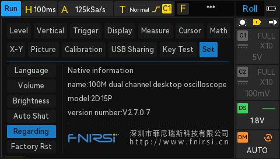
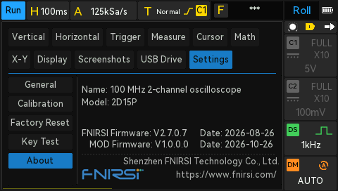
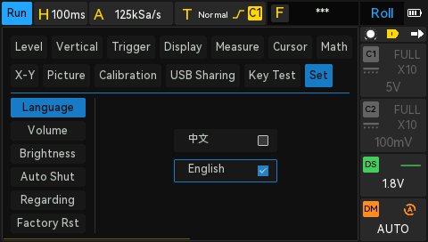
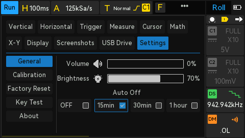
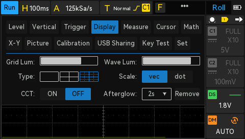
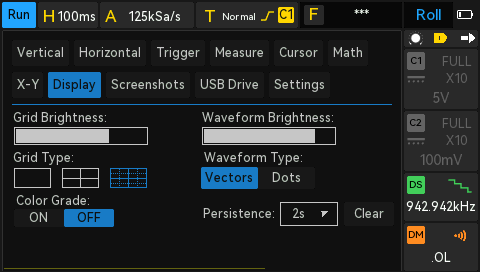

# FNIRSI 2D15P Community MOD

Unofficial firmware improvements for the FNIRSI 2D15P oscilloscope, multimeter, and signal generator.

## What's New

### Interface comparison

| Original | Community MOD |
|---|---|
| **Regarding** | **About** |
|  |  |
| **Set / Language was removed** | **Settings / General** |
|  |  |
| **Display** | **Display** |
|  |  |

### Main changes

- **Language selection has been removed.**  
  This firmware includes **English only**. Additional language versions are not planned at this time.

- **The main menu has been reorganized and refined.**  
  Titles, ordering, parameter names, and on-screen layout were reviewed and adjusted for a cleaner and more consistent user experience, with naming aligned more closely to conventions commonly seen in professional instruments.

- **Navigation via the upper encoder has been added.**  
  On many devices this encoder is unlabeled; on some instruments a similar control is referred to as **Intensity**.

- **Multimeter labels have been renamed and cleaned up** for improved readability and consistency.

- **Typos in the Key Test window have been corrected.**

- **Signal Generator (DDS) controls have been expanded:**
  - Navigation via the **upper encoder (Intensity)** has been added;
  - **Frequency** can now be adjusted with the **Vertical** encoder;
  - **Step** can now be changed by pressing the **Vertical** encoder;
  - **Amplitude** can now be adjusted with the **Horizontal** encoder;
  - **Duty** can now be adjusted with the large lower-right encoder (**Trigger**).

## Download

**MOD v1.0.0.0** — first public release in preparation.

Download the verified firmware and read its release notes on the [Releases page](../../releases). 

## Firmware Update

**Before installing the MOD, install the official FNIRSI firmware V2.7.0.7 and verify that it starts and works correctly on your device.** Only then proceed with installing the Community MOD.

For the update procedure, see the [FNIRSI 2D15P firmware update video](https://www.youtube.com/watch?v=0d-lKbbzeQs).

Use the installation instructions and firmware file provided with the applicable release. Do not interrupt the update process.

## Feedback

Found a bug or have a suggestion? Open an [Issue](../../issues) or join [Discussions](../../discussions).

---

*Independent community project. Not affiliated with or endorsed by FNIRSI.*
